<div align="center">

# QBiscuit

**VTU-QFF-HC-0191** &nbsp;|&nbsp; Tier: **Online**

### 🎮 [Play Andromeda Station: The Last Qubit on itch.io](https://sohampawar.itch.io/the-lost-qubit)
#### 🎬 [Video Link](https://drive.google.com/drive/folders/1S922IWyR1JDmxjOhipljELpujHV0PnG0?usp=sharing)
#### 📽️ [PPT Link](https://drive.google.com/drive/folders/1HhCSCOcXZPTdQXdaeEj4gAzlgiaEjIBj?usp=sharing)

</div>

---

<div align="center">

| | |
| :--- | :--- |
| **Team** | QBiscuit |
| **Team ID** | VTU-QFF-HC-0191 |
| **Tier** | Online |
| **Repository** | [vtu-hc-qbiscuit](https://github.com/vtu-qiskit-fall-fest-2026/vtu-hc-qbiscuit.git) |
| **Organisation** | [vtu-qiskit-fall-fest-2026](https://github.com/vtu-qiskit-fall-fest-2026) |
| **Event** | VTU-QFF Hackathon — VTU-Qiskit Fall Fest 2026 |
| **Play (WebGL)** | [sohampawar.itch.io/the-lost-qubit](https://sohampawar.itch.io/the-lost-qubit) |
| **Quantum backend** | [andromeda-quantum-backend.onrender.com](https://andromeda-quantum-backend.onrender.com/health) (Qiskit Aer on Render) |

</div>

---

## 📌 Table of Contents

- [Team Members](#-team-members-github-ids)
- [Problem Statement](#-problem-statement)
- [Proposed Solution](#-proposed-solution)
- [Approach & Architecture](#-approach--architecture)
- [Tech Stack](#-tech-stack)
- [Project Structure](#-project-structure)
- [The Game (Unity)](#-the-game-unity)
- [How to Run](#-how-to-run)
- [How to Push Code](#-how-to-push-code)
- [Submission Checklist](#-submission-checklist)
- [Resources](#-resources)
- [License](#-license)

---

## 👥 Team Members (GitHub IDs)

| # | Name | GitHub Username | Role |
| :-- | :--- | :--- | :--- |
| 1 | Shriya Nagarkar | tsukinousagi18 | _Team Lead_ |
| 2 | Soham Pawar | SohamPawar246 | _Developer_ |
| 3 | Nikhil Kumar | nikhil2027 | _Developer_ |

<!--
Optional: add a plain list instead of the table above.
- @username1
- @username2
-->

---

## ❓ Problem Statement

<!--
State the problem you are solving. Be specific: what is broken or missing,
who experiences it, and why does it matter. Link to the official problem
statement from the brief if one applies.
-->

**Problem:** Quantum computing concepts such as superposition, measurement, and quantum noise can be difficult for beginners to understand. Learning how quantum errors affect computation and how error-correction techniques work requires accessible, interactive tools.

**Why it matters:** Making quantum concepts visual and interactive can help learners develop practical intuition about quantum circuits, noise, and error correction.

**Track / Category:** Online / Offline · Track: Quantum Hardware and Error Correction · Category: Quantum Education & Error Correction

---

## 💡 Proposed Solution

<!--
Describe your solution. Keep it concrete: the core idea, the user flow, and
the quantum/ML technique you are applying.
-->

**Solution:** Echoes of Andromeda is a story-driven quantum learning game in which players investigate a malfunctioning quantum processor aboard a lunar vessel. Players explore quantum circuits, compare ideal and noisy simulations, and investigate bit-flip errors using Qiskit and Qiskit Aer.

**Key idea:** Integrate interactive Unity-based circuit design with a custom Python compilation pipeline and Qiskit Aer simulation.

**Why this works:** Players can experiment with quantum gates, observe measurement outcomes, and explore syndrome-based error detection and correction through hands-on gameplay.

---

## 🧩 Approach & Architecture

<!--
Walk through how it works. A simple pipeline diagram in text or Mermaid is ideal.
-->

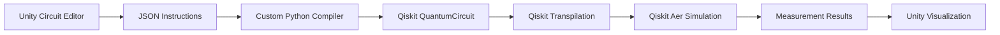

**Input** — Players select quantum gates and qubits through the Unity interface.

**Preprocessing** — Circuit instructions are encoded as JSON and validated by the Python compiler.

**Quantum Core** — The compiler constructs Qiskit circuits, which are transpiled and executed using Qiskit Aer with optional configured noise.

**Post-processing** — Measurement counts and error-diagnosis results are processed to evaluate circuit behaviour and correction outcomes.

**Output** — Unity visualizes circuit results, measurement distributions, and error-detection or correction outcomes.

---

## 🛠️ Tech Stack

| Layer | Technology |
| :--- | :--- |
| Language | Python 3.11+ |
| Quantum SDK | Qiskit `>=1.0`, Qiskit Aer, Qiskit Runtime |
| Optimisation | Qiskit Optimization / COBYLA / SPSA |
| Simulation | AerSimulator (statevector / noisemodel) |
| Environment | JupyterLab / VS Code, `venv` |
| Version control | Git + GitHub |

---

## 📁 Project Structure

```text
vtu-hc-qbiscuit/
├── README.md                        # This file
├── render.yaml                      # Render Blueprint for the quantum backend
├── Andromeda_Backend/               # FastAPI + Qiskit Aer service (deployed on Render)
│   ├── api_server.py                # HTTP API: GET /health, POST /run (CORS for the WebGL build)
│   ├── requirements.txt             # Backend dependencies (Python 3.12)
│   └── quantum_backend/
│       ├── api.py                   # Routes "correct", "simulate" and "noisy" requests
│       ├── circuit.py               # Runs circuits on the Qiskit AerSimulator
│       ├── diagnosis.py             # Diagnostic circuit: encode, inject fault, measure the syndrome
│       ├── verification.py          # Verification circuit: apply the player's fix, check the data
│       ├── compiler.py              # Compiles and simulates player-built circuits ("simulate")
│       └── noise.py                 # Thermal relaxation (T1) model for the cryo puzzle
└── UnityGame/
    ├── Blender/
    │   └── research_room.blend      # Pixel-art research room rendered for the intro
    └── Qubit/                       # Unity 6 project (URP, Input System, uGUI + TextMeshPro)
        └── Assets/
            ├── Scenes/
            │   └── Intro.unity      # The whole game: room → CRT boot → menu → console → ending
            ├── Scripts/
            │   ├── Intro/           # Room view, power-on, typewriter text, blinking prompt
            │   ├── Terminal/        # CRT display, boot sequence, menus, settings, console shell
            │   ├── Comms/           # Comms link dialogue, mission report, ending
            │   ├── Notebook/        # Research notebook, link clicks, Benches/ (hands-on mini labs)
            │   ├── Quantum/         # Backend client, Diagnostics console, Cryo Control, dial
            │   └── Audio/           # Sound bank, ambience, music crossfade
            ├── Data/
            │   ├── Notebook/        # 9 notebook sections (ScriptableObjects, 27 entries)
            │   └── Dialogue/        # Comms transmissions
            ├── Prefabs/UI/          # Terminal menu item and option row
            ├── Shaders/             # UI_CRT shader (curvature, scanlines, phosphor glow)
            ├── Materials/           # CRT material
            ├── Fonts/               # VT323, IBM Plex Mono, Noto Sans Math (SDF)
            ├── Art/                 # Room and UI art
            ├── Audio/               # Sound effects and Music/ (two looping tracks)
            └── StreamingAssets/
                └── ResearchNotebook.pdf   # Full notebook, opened from the DOCS tab
```

**How the pieces talk:** the WebGL build on itch.io sends each circuit request to `https://andromeda-quantum-backend.onrender.com/run`, which runs it on Qiskit Aer and returns the result. In the Unity editor the game uses a local server at `http://127.0.0.1:8000/run` instead. If the hosted server can't be reached, the game falls back to a clearly labelled offline stand-in.

---

## 🎮 The Game (Unity)

**Andromeda Station: The Last Qubit** is a short, educational puzzle game played entirely on a retro CRT terminal.

▶ **Play in the browser:** [sohampawar.itch.io/the-lost-qubit](https://sohampawar.itch.io/the-lost-qubit)

### Story

It is the polar night at an Antarctic research station. At **02:17 UTC** a mission specialist on a lunar spacecraft makes contact: the ship's latest control calculation, run on its experimental quantum processor, **failed its validation check**. As the researcher on duty, you must find the fault, correct it, find out *why* it happened, and send back a verified report.

### Game flow

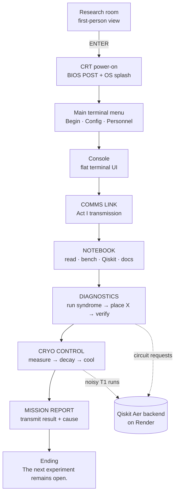

### Modules

| Module | What the player does | What it teaches |
| :--- | :--- | :--- |
| **Comms Link** | Answers the lunar vessel's typed transmissions | The mission and the failed validation |
| **Notebook** | 9 sections / 27 entries with READ, BENCH (hands-on mini labs), QISKIT code and DOCS tabs; links to IBM Quantum guides and the full notebook PDF | Qubits, X and CNOT gates, parity, the repetition code, shots |
| **Diagnostics** | Runs the 3-qubit bit-flip repetition code, reads the syndrome lamps (`00/10/11/01`), places the correcting X gate and verifies. Live, collapsible generated Qiskit code mirrors the backend circuit | Error detection, syndromes, correction, verification |
| **Cryo Control** ("Hold the Qubit") | 1. Scan three qubits to find the leaky one. 2. Chart its survival against hold time to measure T1. 3. Turn the cooling dial so it keeps \|1⟩ ≥ 90% at 40 µs, then try ENCODE ×3 | T1 energy relaxation, why qubits are kept cold, how error correction helps |
| **Mission Report** | Transmits the verified result, its cause and the mitigation | Closing the scientific loop |

Every diagnosis, verification and cryo scan is a real circuit run on **Qiskit Aer**. If the server can't be reached, a clearly labelled *offline stand-in* keeps the game playable — the game never fakes a Qiskit result.

### Screenshots

| | |
| :---: | :---: |
| 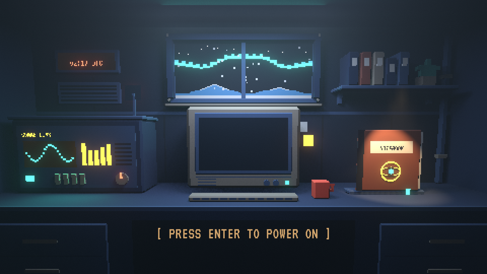<br/>Research room | 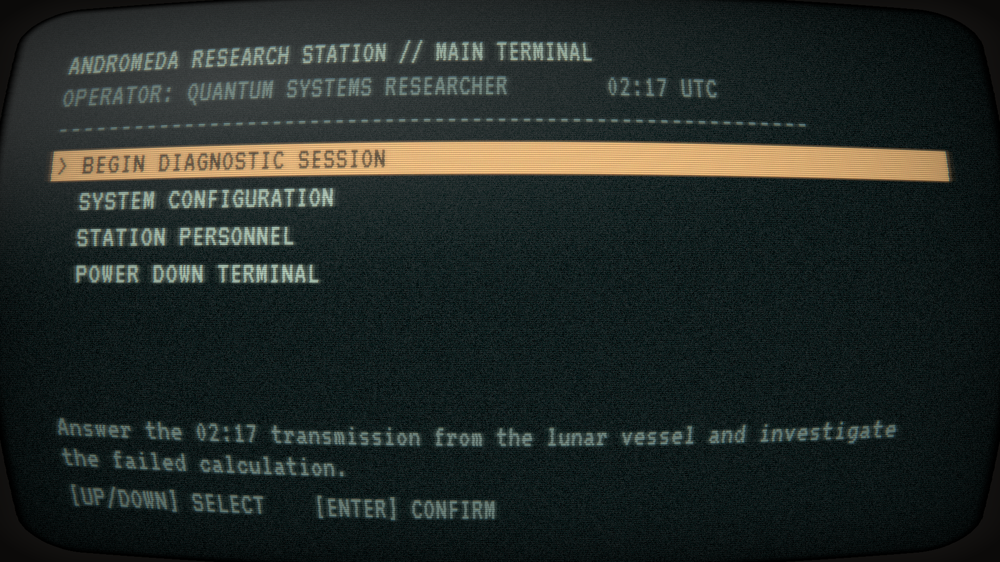<br/>Main terminal (CRT) |
| 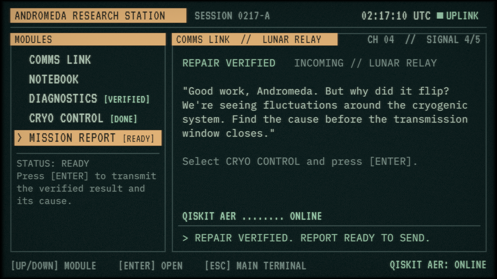<br/>Console and modules | 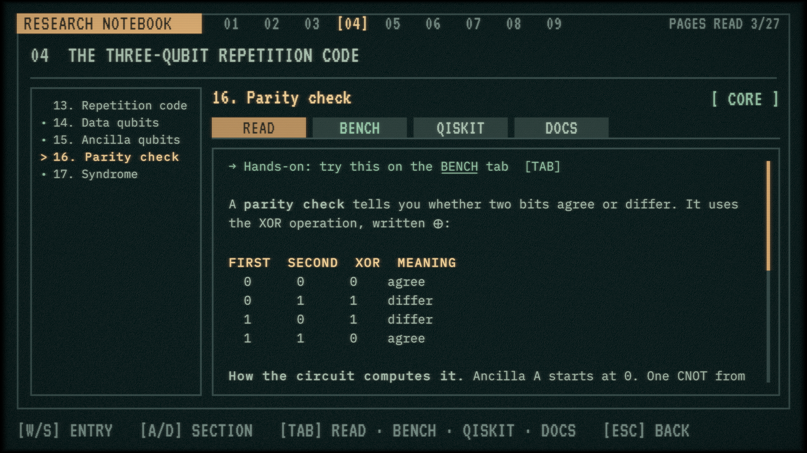<br/>Research notebook |
| 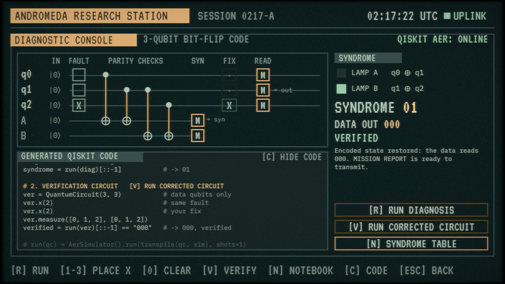<br/>Diagnostics: repair verified | 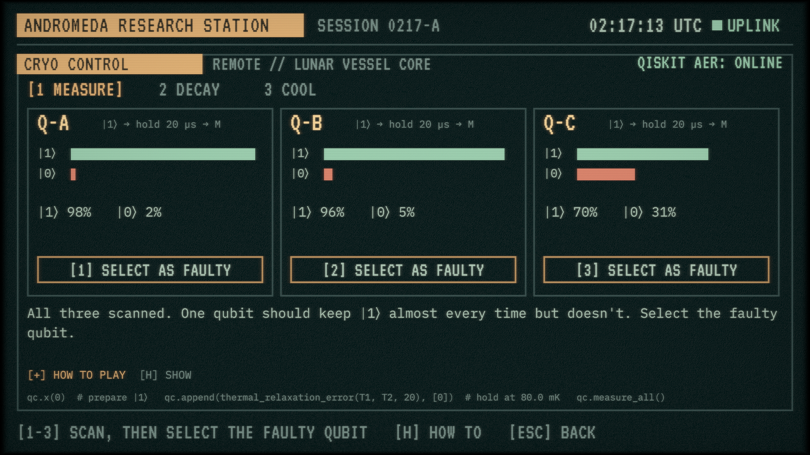<br/>Cryo 1: measure |
| 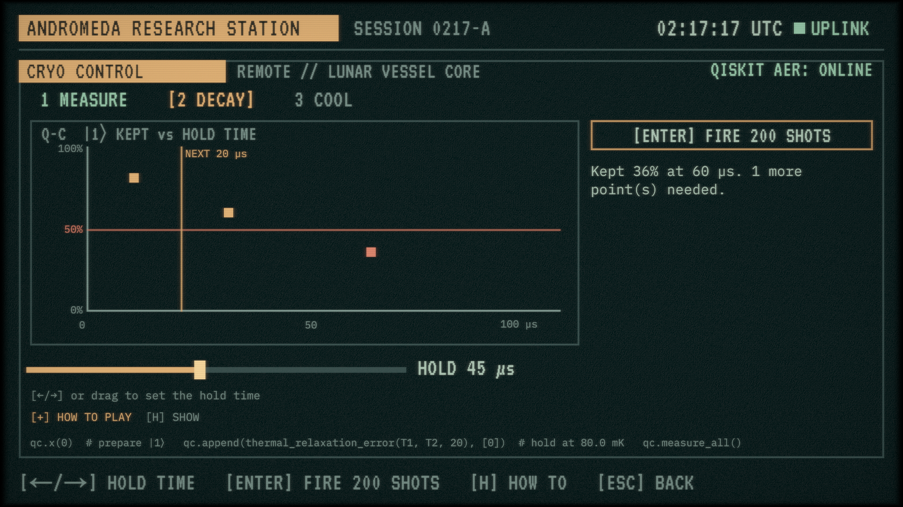<br/>Cryo 2: decay chart | 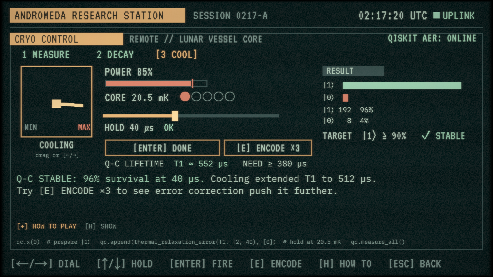<br/>Cryo 3: cooling, stable |
| 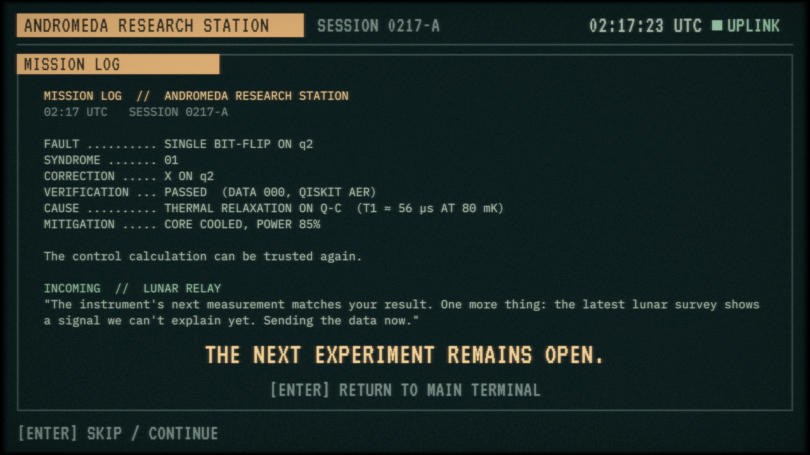<br/>Mission log and ending | |

### How the game talks to Qiskit

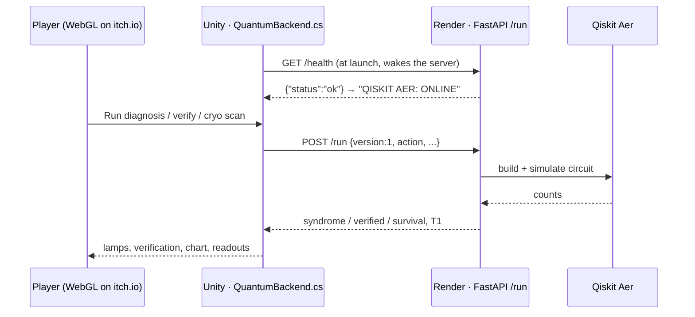

### Tech and design

| Area | Choice |
| :--- | :--- |
| Engine | Unity 6 (6000.3.10f1), URP, new Input System |
| UI | uGUI + TextMeshPro, built as real scene UI (no procedural layouts) |
| Look | Custom `UI_CRT` shader (curvature, scanlines, phosphor glow) that blends from tube to flat; palette: teal `#101B1D`, sage `#A2B8A8`, aged amber `#D0A46D`, phosphor `#E3C58F`, mint `#8FBCA0`, coral `#C87963` |
| Art | Pixel-art research room modelled in Blender (`UnityGame/Blender/research_room.blend`) |
| Fonts | VT323, IBM Plex Mono, Noto Sans Math (SIL OFL 1.1) |
| Audio | Synthesised retro SFX (keys, beeps, degauss, compute), ambience, two crossfading music tracks |
| Data | Notebook sections and dialogue as ScriptableObjects (`Assets/Data`) |
| Networking | `UnityWebRequest` to the Render backend; editor uses `http://127.0.0.1:8000/run`, builds use `https://andromeda-quantum-backend.onrender.com/run` |
| Build | WebGL, Gzip + decompression fallback, custom `Andromeda` page template for itch.io |

### Controls

| Key | Action |
| :--- | :--- |
| `ENTER` | Confirm / continue / fire |
| `↑ ↓` / `W S` | Move through menus |
| `ESC` | Back |
| `TAB` · `A D` | Notebook tabs · sections |
| `R` · `1–3` · `V` | Diagnostics: run · place X · verify |
| `C` · `N` | Show/hide Qiskit code · open notebook |
| `← →` · `↑ ↓` · `E` | Cryo: dial or hold time · hold time · encode ×3 |
| `H` | Show/hide HOW TO PLAY |

### Running the Unity project

1. Open `UnityGame/Qubit` in **Unity 6000.3.10f1** and load `Assets/Scenes/Intro.unity`.
2. (Optional) start the backend locally so the editor uses real Qiskit:
   ```bash
   cd Andromeda_Backend
   uv run --no-project --python 3.12 --with-requirements requirements.txt uvicorn api_server:app --host 127.0.0.1 --port 8000
   ```
   Without it the game uses the labelled offline stand-in.
3. Press **Play**, then **ENTER** to power on the terminal.
4. To build for itch.io: *File → Build Profiles → Web*, build to `UnityGame/Builds/WebGL`, zip the folder contents (with `index.html` at the root) and upload as an HTML game (960 × 540, fullscreen button on).

---

## 🚀 How to Run

### Prerequisites

- Python 3.11 or newer
- [Git](https://git-scm.com/downloads)
- A GitHub account (you need collaborator access to this repo)

### 1. Clone the repository

```bash
git clone https://github.com/vtu-qiskit-fall-fest-2026/vtu-hc-qbiscuit.git
cd vtu-hc-qbiscuit
```

### 2. Create a virtual environment

```bash
python3 -m venv .venv
source .venv/bin/activate        # Linux / macOS
# .venv\Scripts\activate         # Windows (PowerShell)
```

### 3. Install dependencies

```bash
pip install --upgrade pip
pip install -r requirements.txt
```

### 4. Run

```bash
python -m src.main
```

Or launch the notebook workflow:

```bash
jupyter lab
```

### 5. Run the tests

```bash
pytest -q
```

---

## 🔁 How to Push Code

> Full walkthrough: **[Git & Collaboration Handbook](../vtu-hc-guide-git-and-collaboration)** — collaboration
> workflow, branches, pull requests, reviews and conflict resolution.

### Configure Git (first time only)

```bash
git config --global user.name  "Your Name"
git config --global user.email "you@example.com"
```

### Everyday workflow

```bash
# 1. Get the latest changes
git checkout main
git pull origin main

# 2. Create a branch for your work
git checkout -b feature/my-task

# 3. Commit your work
git add .
git commit -m "feat: add variational circuit for the search problem"

# 4. Push the branch
git push -u origin feature/my-task

# 5. Open a Pull Request on GitHub and request a review
#    https://github.com/vtu-qiskit-fall-fest-2026/vtu-hc-qbiscuit/compare/main...feature/my-task

# 6. After approval, merge into main
git checkout main
git pull origin main
git branch -d feature/my-task
```

### Commit message convention

| Prefix | Meaning |
| :--- | :--- |
| `feat:` | New feature |
| `fix:` | Bug fix |
| `docs:` | Documentation only |
| `test:` | Adding or fixing tests |
| `refactor:` | Code restructure, no behaviour change |
| `chore:` | Build/config/dependency changes |

### Useful commands

```bash
git status              # what changed
git log --oneline -10   # recent commits
git diff                # review changes before committing
git stash               # shelve changes temporarily
git pull --rebase       # update your branch on top of main
```

### Collaborating on the same repo

- **Never push directly to `main`** — open a Pull Request.
- **Pull before you push** to avoid rejected commits.
- **Commit often** with clear messages.
- **Resolve conflicts** locally: `git pull --rebase`, fix the files, then `git add` + `git rebase --continue`.
- **Ask for a review** before merging — a second pair of eyes catches bugs fast.

---

## ✅ Submission Checklist

- [x] Repository created and **public**
- [x] All team members added as **collaborators** and invitations accepted
- [x] `README.md` updated with project details, problem statement and solution
- [x] Team members listed under [Team Members](#-team-members-github-ids)
- [x] `requirements.txt` committed and project runs from a clean clone
- [x] Code pushed to `main` and the latest `main` builds successfully
- [ ] Notebooks committed with **cleared outputs** (or use `nbstrip`)
- [x] `README` includes a demo screenshot / video link
- [ ] Short project summary submitted on the hackathon portal

---

## 📚 Resources

| Resource | Link |
| :--- | :--- |
| 🔁 Git & collaboration handbook | [Git & Collaboration Handbook](../vtu-hc-guide-git-and-collaboration) |
| ❓ Problem statements, solutions & terms | [Problem Statements, Solutions & Terms](../vtu-hc-guide-problem-and-solution) |
| 📄 README writing guide | [README Guide & Template](../vtu-hc-guide-readme-template) |
| ⚛️ Qiskit documentation | https://docs.quantum.ibm.com/ |
| ⚛️ Qiskit Runtime & primitives | https://quantum.cloud.ibm.com/docs/ |
| 🧪 Qiskit Aer simulator | https://docs.quantum.ibm.com/guides/simulator |
| 💻 IBM Quantum Platform | https://quantum.cloud.ibm.com/ |
| 🎓 Qiskit textbook | https://qiskit.qotlabs.org/learning/ |
| 📋 GitHub Docs | https://docs.github.com/ |

---

## 📄 License

Released under the [MIT License](LICENSE). See `LICENSE` for details.

---

<div align="center">

**QBiscuit** · Team ID `VTU-QFF-HC-0191` · Tier `Online`
· Built with ⚛️ Qiskit for the VTU-QFF Hackathon

[⬆ Back to Top](#qbiscuit)

</div>
